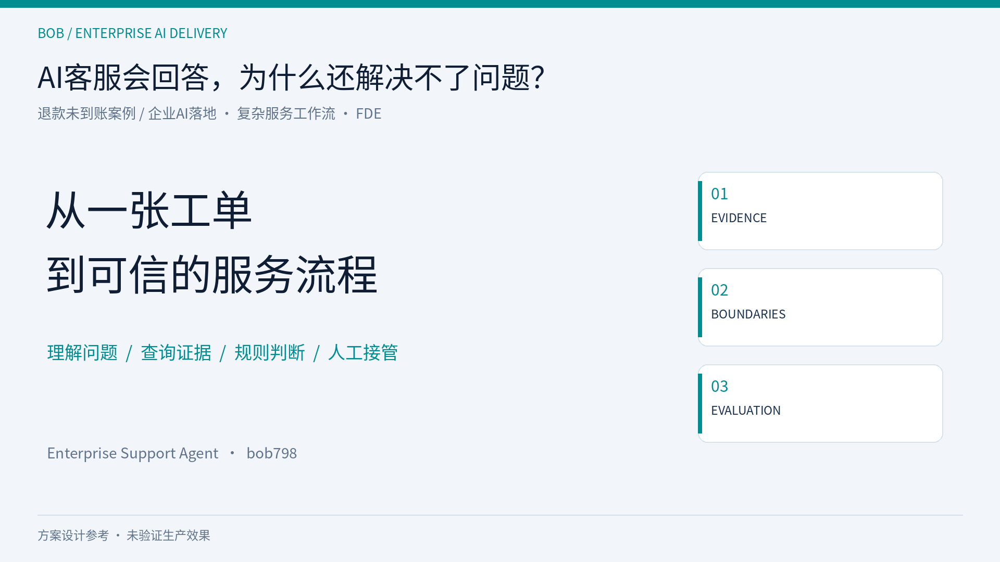
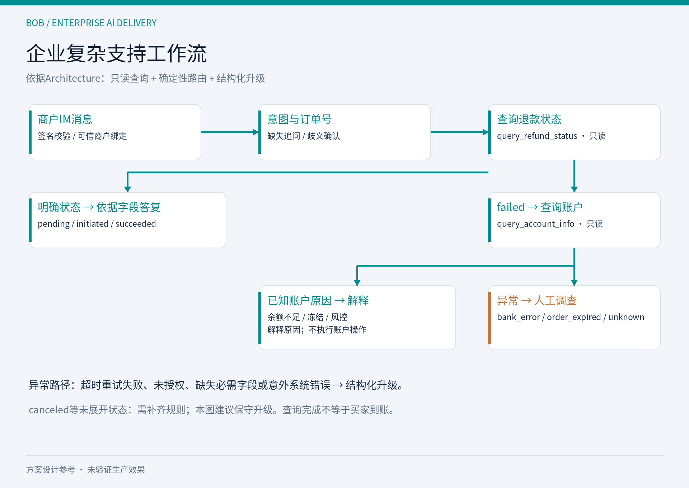
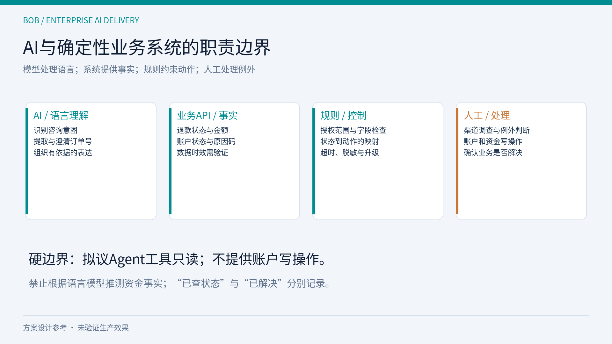
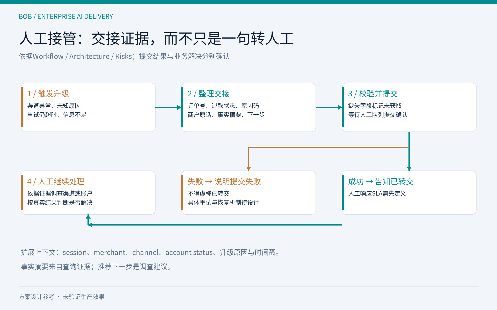

# 退款没到账：如何设计一个受控的Agent工作流？

**副标题：从Tool Calling到确定性路由、人工接管与Evaluation**

**摘要：**用一个B2B退款支持设计案例，拆解语言模型、只读工具、规则和人工队列的责任。重点讨论工具契约、异常分支与评测，不将代码草案或测试目标包装成已验证能力。



## 1. 输入是自然语言，输出必须可核对

商户说“退款发起了，买家没收到”。一个RAG系统能解释政策，但无法仅凭政策确认某笔退款的事实。这个场景需要的是受控调查：补全订单号，查询交易系统，必要时查询账户系统，生成有依据的答复或交接。

Enterprise Support Agent提供了这一流程的设计文档。主README声明Demo与实测结果尚未发布；仓库已有LangGraph代码草案、路由代码和Mock连接器，但本次未运行验证。本文介绍设计及其需要核对的工程边界，不把文件存在等同于功能已完成。

## 2. Workflow优先于自由规划

Architecture把流程拆成IM Adapter、Intent Classifier、Information Collector、两个查询工具、Result Router、Response Generator和Escalation Builder。

LLM负责识别退款咨询与抽取订单号。缺失就追问，多编号有歧义就确认。文档采用0.7作为意图置信阈值，低于阈值先澄清。这是可调的设计参数，不是已经校准的准确概率；上线前要用边界样本验证。



进入查询之后，不需要模型重新创造一条处理路径。pending、initiated、succeeded走标准答复；failed查账户。已知账户原因可以解释，银行异常、订单失效或未知原因进入升级。规则明确的部分可以由状态机实现，使行为可复现、易定位。

仓库路由草案确实使用了确定性分支，但这不证明它已满足所有验收项。必须检查规则是否完整覆盖业务枚举，以及状态来自哪个系统、代表哪个处理阶段。

## 3. Tool Calling不是信任边界

query_refund_status的设计输入是订单号，输出包括状态、金额、币种和预计到账时间；query_account_info返回账户状态及失败原因码。工具层拟议为只读，不提供重试退款或修改账户的方法。

但只读也可能泄露别的商户数据。IM会话预绑定身份，只是输入前提；服务端仍需验证签名，从可信绑定获取merchant_id，并限制订单查询范围。不能从用户消息中直接接受商户身份。

工具契约还应明确空字段、未找到、未授权和超时的含义。模型不能把null补成“处理中”，也不能从“余额正常”推断银行已完成退款。建议在真实连接器接入前，把生产返回值映射成统一字典并测试映射。

下面是基于文档的路由伪代码，并非本次验证过的可运行实现：

```python
if lookup_error:
    handle_error_or_handoff(lookup_error)
elif status in {"pending", "initiated", "succeeded"}:
    validate_fields_then_reply(tool_result)
elif status == "failed":
    account = query_account_info(account_id)
    route_by_failure_reason(account)
else:
    handoff(reason="unmapped_status")
```

输出字段检查与路由是两件事。走到答复分支后，如果必需字段缺失，仍然不能生成资金事实。生产时效应来自适用政策或可信字段，文档中的示例天数不能直接当通用规则。

## 4. 确定性规则也需要审查

当前文档有值得在实现前修正的差异：Workflow使用success，Architecture使用succeeded；余额不足原因存在insufficient_balance与insufficient_funds两种写法；工具枚举包含canceled，但主要决策树没有展开对应分支。

这些不是文案问题。一个字符串不一致，就可能把预期答复变成默认升级，或走入错误分支。应建立状态与原因码的规范表，并明确未知值如何处理。



资金与账户写操作在本案例中属于人工范围。不能因为Prompt写了“不要操作账户”就认定边界有效；工具暴露、授权检查和测试都需要支持同一约束。

## 5. Human-in-the-loop要保留上下文

设计中的升级触发包括bank_error、order_expired、unknown，以及重试后仍超时、订单号确认后仍查不到、信息收集失败和意外系统错误。

Workflow的基础payload包含订单号、状态、失败原因码和商户原话。Architecture扩展了会话、商户、渠道、账户状态、升级原因、建议下一步及时间戳。Acceptance要求检查关键字段完整性。



交接中的agent_reasoning应理解为简短事实摘要，不是模型内部推理链。未查到的信息要标记未获取并说明原因；推荐下一步是建议，不能当作已确认根因。工单发送成功后才可以告诉商户已转交，人工SLA仍需配置。

“正确升级”与“业务解决”要分别记录。否则转人工率下降，可能只是系统把该升级的案例留在了自动回复里。

## 6. Evaluation验证每个危险转折

Acceptance定义F1–F10、S1–S5和非功能门槛，规划最低160条样本。这些尚未形成已执行的评测结果，不能称为“160条测试全部通过”。

建议按层检查：意图与编号抽取，工具输入与返回处理，路由选择，字段引用，升级payload，以及越权和隐私边界。每条样本要记录预期分支与允许输出，而不只是参考答案。

关键负例包括多编号、空状态、未知原因、接口超时、伪造身份和要求重试退款。还要检查succeeded但商户仍说未到账时，答复是否要求进一步确认，而不是自动宣称已解决。

评测数据集各行数量合计160，并不意味着所有验收项目都只需这160条；性能测试和接口调用次数还有独立计划。同一用例可能覆盖多个标准，实际执行前要统一数据集、指标分母和签核证据。

Mock阶段验证可控输入下的行为；真实接口阶段验证授权、时效和错误语义。两者不可互相替代。P95延迟、每会话成本和业务ROI，都只能按实际环境测量后报告。

## 7. 下一步交付一个可证实的切片

实施时，还应保留可定位的执行记录：输入被归一化成什么、查询是否成功、返回了哪些字段、规则选择了哪个分支、输出检查是否通过、交接提交是否确认。日志需要脱敏，避免把完整账号和余额扩散到追踪系统。这样出现错误时，可以区分模型理解、连接器映射、业务规则与交接通道的问题，而不是只看到最终一句答复。观察记录本身也必须验证；配置了追踪工具，不等于所有关键节点已经被覆盖。

仓库采用Discover → Design → Build → Validate → Operate循环。对第一版，与其接入所有渠道，不如先限定单一入口、两类只读查询和清晰的升级路径，用历史工单及异常样本检查闭环。

公开设计的价值，是让业务流程、工具契约和评测对象同时可讨论。真正工程化交付时，还需把未决问题变成可测试实现，并补充运行与签核证据。

如果你在做企业技术支持、SaaS客服或AI实施，请评论或私信**JJ-REFUND**，提供脱敏客户原话、系统清单、人工判断节点和解决标准。我想收集真实的复杂服务案例，共同判断哪些环节适合只读工作流，哪些必须交给人。

源码与设计：[Enterprise Support Agent](https://github.com/bob798/enterprise-support-agent/tree/main/examples/refund-not-received)

**话题标签：**#AI #Agent #LangGraph #后端 #架构 #Evaluation
