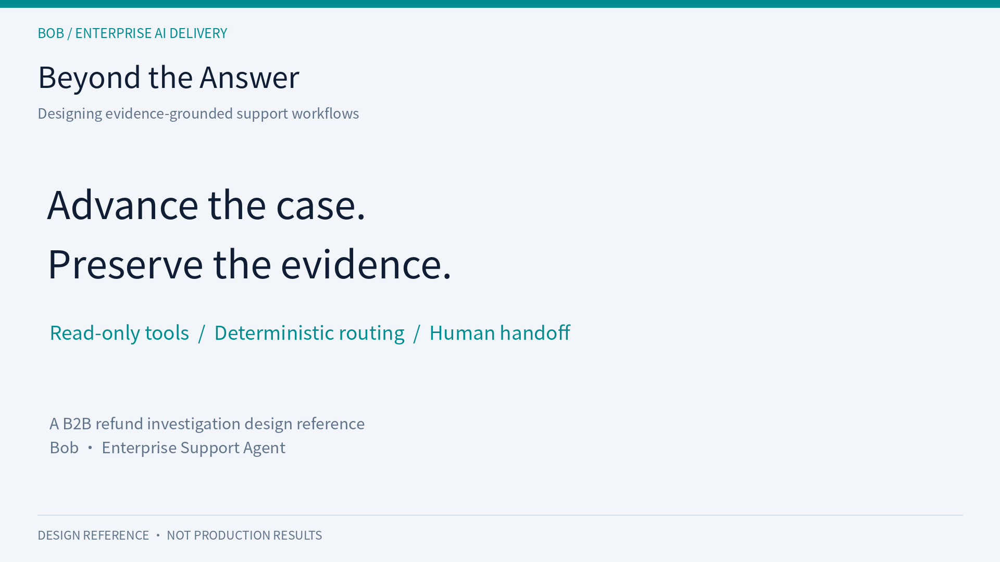

# An AI Support Agent Can Answer a Question. Can It Advance the Case?

**Subtitle:** A refund investigation design case for FDEs and AI solutions architects

**Summary:** Enterprise support requires evidence, bounded actions, and a usable handoff. This open-source design reference explores those requirements through a B2B payment refund workflow, without claiming validated production results.

## The gap appears after the first answer

A merchant contacts a payment provider: “We initiated the refund, but the buyer still has not received it.”

A knowledge assistant can explain refund policies. That may be useful, but it does not establish what happened to this transaction. The support engineer needs an order identifier, a transaction lookup, and sometimes an account investigation. A channel or operations team may need to take over.

The job is to gather evidence and advance the case responsibly. A fluent answer alone does not establish that the customer's problem is resolved.

I am documenting this problem in Enterprise Support Agent, an open-source enterprise AI delivery reference. The refund example contains Discovery, Workflow, Architecture, Risks, and Acceptance documents. The repository also contains agent code drafts and mock connectors. I have not validated their execution for this publication; the main README states that a runnable demo and measured results are not yet released. This is a design case, not a production success story.

## Start with the work, not the model

The case concerns B2B merchants contacting a payment company's technical support team. It is not a consumer-facing refund execution bot.

The discovery material draws on a payment support practitioner interview. It describes requesting an order number, checking the transaction system, interpreting the result, checking account conditions when necessary, and escalating unresolved cases.

Reported handling times are practitioner estimates, not a measured baseline. They suggest a reason to investigate automation, but they cannot support a realized ROI claim. A customer deployment would first need to separate active investigation time from time spent waiting for another team.

The custom suitability score of 19/21 is a prioritization device, not an external certification. More consequential are the open prerequisites: API access, identity and authorization, escalation ownership, historical tickets, and an agreed definition of resolution.

An FDE engagement becomes concrete when those assumptions become explicit delivery requirements.

## Separate language, facts, and decisions

The proposed workflow uses an LLM to recognize the inquiry and collect missing information. It then queries a read-only refund-status tool. A failed refund leads to an account-information lookup.

Routing is deterministic. Clear statuses lead to grounded responses; known account conditions can be explained; bank errors, expired orders, and unknown causes are handed to a human investigator.

The model does not decide financial facts. Business APIs provide status and account conditions. Rules govern the allowed transitions. Human staff handle account writes and cases beyond the available evidence.

Tool calling does not, by itself, establish reliability. A tool may return stale data, an unmapped status, or a missing field. A successful lookup does not mean the buyer has received the funds. A response should communicate both the evidence obtained and the remaining uncertainty.

Likewise, a pre-bound messaging identity does not remove the need for server-side authorization. The design includes authenticated merchant binding, webhook validation, and merchant-scoped queries. These controls still require implementation and testing.

## Make the boundary enforceable

The proposed tool layer is read-only. Retrying a refund or changing account state is outside the agent's scope and requires authorized human handling.

A prompt is insufficient evidence that this boundary holds. Tool exposure, service authorization, error handling, and adversarial tests should enforce the same policy.

There are also document inconsistencies to resolve before implementation: success versus succeeded, differing names for insufficient funds, and a canceled status that is not fully elaborated in the main decision tree. A deterministic system can reproduce an incorrect mapping very consistently. The business dictionary and fallback behavior need review.

The proposed response templates include example timelines. Those should not become universal payment promises. Actual guidance must be grounded in the applicable policy and available transaction data.

## A handoff is an engineering artifact

“Please contact support” is not a complete handoff.

The workflow proposes a basic payload containing the order ID, refund status, failure reason, and original merchant message. The architecture extends it with session context, account status, escalation reason, a suggested next step, and timestamps.

That payload should preserve evidence already collected. Missing information should be explicitly marked as unavailable. A suggested investigation step should remain a suggestion, not be presented as a verified root cause.

The handoff summary should be a concise account of retrieved facts, rather than hidden model reasoning. The system should only claim that a case has been transferred after the queue or ticket system confirms submission. Human response times remain an unresolved deployment requirement.

This makes human-in-the-loop a continuity mechanism. The target is a case that another person can continue, with less repetition and a clear explanation of why automation stopped.

## Evaluate the transitions that matter

The acceptance document defines functional, safety, and non-functional criteria, with a proposed minimum dataset of 160 cases. Those are planned tests, not an executed suite with published pass rates.

The evaluation should distinguish intent recognition, order identification, tool use, routing, factual grounding, payload completeness, and unauthorized actions. A single aggregate quality score can hide consequential errors.

Useful edge cases include multiple identifiers, missing output fields, unknown status codes, repeated timeouts, forged identities, write-action requests, and a successful system status followed by a merchant reporting non-receipt.

Mock tests establish behavior under controlled inputs. They do not establish real API authorization, freshness, channel reliability, or business impact. Those require separate validation.

The same distinction applies to latency, cost, and ROI targets. No production improvements are claimed here.

## The reusable asset is a delivery loop

The repository organizes delivery as Discover → Design → Build → Validate → Operate.

For an FDE or AI solutions architect, each phase should produce reviewable evidence: a problem boundary, tool contracts and acceptance criteria, a working vertical slice, evaluation records, and operational feedback.

The pattern may extend to SaaS state inconsistencies, subscription billing, or e-commerce investigations. The business rules should not be copied wholesale. Identity, permissions, timing, and resolution criteria must be discovered again.

The refund case is a starting point for that discussion: how to turn an ambiguous service request into a bounded, testable workflow.

**Call to action:** If you lead enterprise technical support, SaaS service operations, or AI implementation, comment or message **LI-REFUND** with an anonymized case: the customer's request, systems involved, the human decision point, and what counts as resolution. We can discuss whether a read-only investigation workflow is an appropriate first slice.

Design documents: https://github.com/bob798/enterprise-support-agent/tree/main/examples/refund-not-received

**Topics:** Enterprise AI · FDE · AI Solutions Architecture · Agent Engineering · Customer Support
