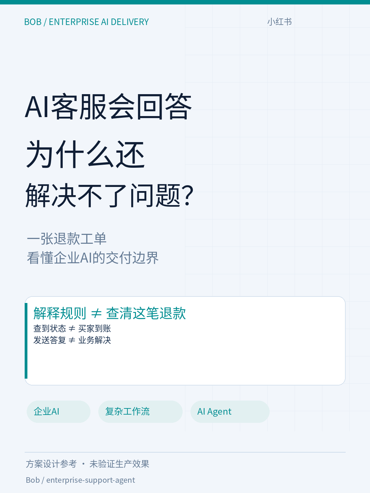
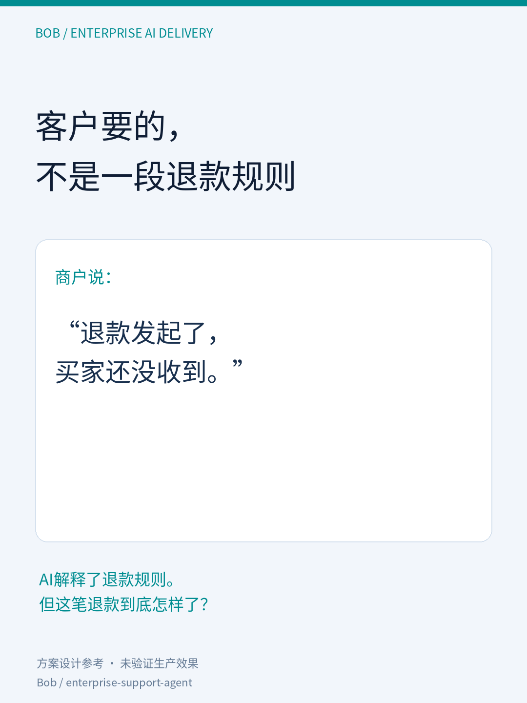
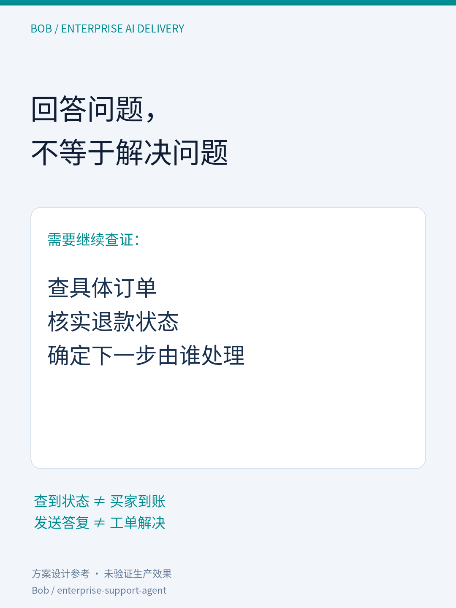
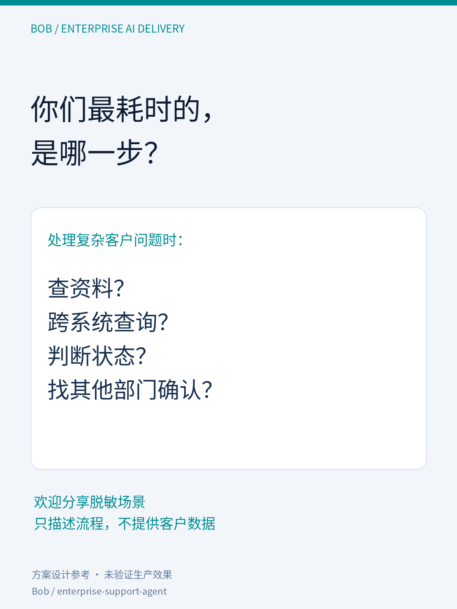

# 小红书第一篇：回答与解决的区别

状态：待发布，未发布到小红书。已压缩为4页；正文约200字，一个场景、一个判断、一个提问。

上传顺序：

1. 01-cover.png：AI客服会回答，为什么还解决不了问题？
2. 02-scenario.png：AI解释规则，客户却需要查清一笔退款。
3. 03-insight.png：查订单、核实状态、确定下一步；查到状态不等于解决问题。
4. 04-question.png：邀请分享实际耗时节点。

正文直接使用post.md，首行作为标题，话题置于末尾。全部图片1080×1440。

## 发布策略

目标读者：技术支持、SaaS客服、企业AI实施人员。
目标：获取具体业务场景，通过评论/私信了解系统、人工判断和解决标准。
第一篇不展开技术栈、160条测试或ROI；保留设计阶段说明。

评论首轮承接：这个问题涉及哪些系统？最难的是查询、判断，还是等其他部门确认？只需描述脱敏流程。

来源记录：本文评论与私信标记xiaohongshu/refund-01；没有明确来源的咨询记“来源待确认”。不声称存在自动埋点。

后续选题：跨系统调查 / 转人工交接 / 企业AI验收，每篇分别展开。
