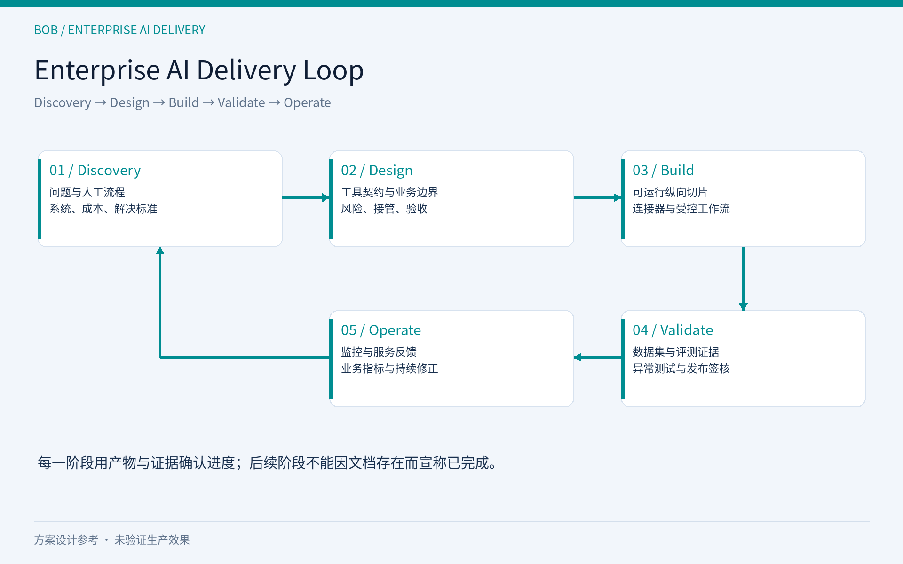

# AI客服能回答退款问题，为什么仍然解决不了退款工单？

**副标题：一个B2B支付案例，拆解企业Agent的证据、权限与交付边界**

**摘要：**“退款没到账”往往不是知识库问题，而是跨系统调查。本文基于开源项目Enterprise Support Agent的设计文档，讨论如何从Discovery走向受控工作流、人工接管与验收，并明确哪些能力尚未验证。

## 一、回答正确，为什么工单还在？

商户发来一句话：“退款已经发起了，买家说还没收到，帮忙查一下。”

知识库型AI可以很快解释退款规则，甚至给出一段礼貌、完整的答复。但技术支持负责人真正关心的是：这笔退款究竟处于什么状态？当前证据能证明到哪一步？谁负责下一步调查？如果系统返回的信息有歧义，客服是否会误把问题关闭？

这是我公开整理Enterprise Support Agent时选择的第一个场景。它面向支付公司服务商户的B2B技术支持，不是消费者自助退款，也不是自动执行资金操作。项目目前是设计参考：已有Discovery、Workflow、Architecture、Risks和Acceptance文档。仓库也存在Agent代码草案及Mock连接器，但本次没有运行验证，不能据此宣称Demo已交付、生产接口已打通或业务效果已取得。

这个边界很关键。公开案例的价值，是让读者检查问题如何被拆开、风险如何进入设计、验收如何定义，而不是用规划中的指标证明产品成熟。

## 二、先定义支持工作的产出

Discovery记录的人工流程很短：索取订单号，查询订单或交易系统，判断结果；如果状态不清楚，再查询账户系统；无法处理时交给高级支持或运营。

真正耗时的地方藏在“判断结果”中。订单系统的成功，可能只是某个处理阶段成功；商户说的“没到账”，却指向消费者实际收款。两个表述可以同时成立。如果AI只复述一个状态码，语句可能准确，业务解释仍然不完整。

因此，我把这个工作的产出定义为：跨系统收集证据，识别允许的下一步，给出有依据的解释，必要时完成可继续处理的交接。查询完成、回复发送、问题解决是三个不同事件。只有把它们分开，后续才不会把回复率当作解决率。

访谈文档记录了简单工单约五分钟、复杂调查约半天等经验估计。这些是特定实践者的描述，不是统计基线。企业若要据此立项，仍需抽样历史工单，区分实际操作时间、等待时间和总历时，并记录不同异常的占比。否则，即使模型加速了回复，也可能没有缩短跨部门等待。

## 三、Discovery要回答的不是“能不能用AI”

企业常从模型选型开始讨论。但如果订单号从哪里来、账户归属怎么验证、失败原因谁解释都没有明确，模型越灵活，越容易把缺口掩盖成流畅回答。

案例采用七维自定义评分，得到19/21，作用是筛选是否值得进入设计。它不是外部认证，也不能证明ROI。更有价值的是评分之后暴露的前提：订单与账户API是否可访问，升级请求交给谁，历史工单能否用于评测，退款时效规则由谁维护。

面向CTO，Discovery还要判断集成成本是否超过收益；面向支持负责人，要判断哪些工作实际可重复；面向企业AI负责人，要判断正确答案是否有可核对的来源。三者需要共同确认范围，而不是各自理解一个“AI客服”。

第一版可以只覆盖退款状态咨询，把账户写操作明确排除。范围窄一些，反而容易形成可验收的纵向切片：一条真实输入，经过受控查询，得到可追溯答复或人工交接。

## 四、将自然语言入口接到确定性流程

拟议流程从商户IM消息开始。语言模型识别咨询意图并提取订单号；缺少订单号就追问，多个编号有歧义就确认。随后调用只读工具查询退款状态。

对于pending、initiated、succeeded，设计给出基于工具字段的标准答复；failed则继续查询账户信息。余额不足、账户冻结或风控可以解释已知原因；银行异常、订单失效和未知原因进入人工升级。这里“可以解释”不等于“可以代为处理账户”。

这套设计不是让LLM自由选择所有动作。模型处理自由文本和表达，规则负责状态到动作的映射，业务系统提供资金事实。Tool Calling只是连接动作的机制：调用成功不自动意味着数据足够、归属正确或业务已解决。

真实工具契约还需要核对租户归属、字段含义、错误类别与数据更新时间。文档中IM会话预绑定商户，不代表可以省略服务端授权。消息签名与可信身份绑定、查询范围限制，仍是设计中的必要控制。

对迟迟未到账的解释也不能套用一个通用天数。Architecture中出现的“3–5个工作日”是示例话术，实际发布产品时要连接适用渠道和政策；缺少预计到账字段时，应说明证据不足，不能让模型补一个日期。

## 五、AI和业务系统如何分工

“Agent工程化”不只是增加几个提示词。关键是让不同组件承担适合它的责任。

AI负责识别用户在问什么、发现信息缺口、组织有依据的说明。业务系统负责返回真实状态和账户条件。确定性程序负责校验输入、限制查询范围、映射分支、检查输出字段、处理超时和敏感信息。人工负责渠道调查、账户操作与需要专业判断的例外。

例如，商户要求“直接帮我重试退款”，不能因为模型理解了意图就授予写权限。本案例拟议工具层只读；需要资金或账户操作时交给有权限的人。对只读流程的评测，也应包含写操作诱导，检查系统是否越出范围。

规则同样会出错。Workflow用了success，Architecture用了succeeded；余额不足原因也存在不同命名；canceled出现在工具输出枚举中，却没有同样完整的业务分支。实现前必须统一状态字典，并为未识别值设置保守路径。确定性意味着行为可复现，不意味着业务规则天然正确。

## 六、人工接管需要交接证据

很多客服系统把转人工视为失败。但对复杂支持而言，合理升级是可靠性的一部分。真正的失败是：AI没有证据却做出结论，或者转人工后让客户重新讲一遍。

本案例的Workflow提出四个基础交接字段：订单号、退款状态、失败原因码和商户原话。Architecture进一步扩展会话、商户、渠道、账户状态、升级原因、建议下一步与时间戳。Acceptance要求检查关键字段完整性。

交接说明应是基于已查询事实的简短摘要，而不是暴露模型内部思维过程。工具失败时，字段应标记未获取并说明原因；建议调查方向也必须与证据分开，不能包装成已经确认的根因。

还要验证交接是否真的进入人工队列。工单提交失败与成功是不同状态，不能都回复“已转交”。人工响应SLA在文档中仍待定义，因此不能提前承诺具体时间。账户冻结的解释可能自动生成，但解除冻结仍由人工处理，这也不是端到端自动解决。

## 七、用验收证明流程，而不是证明文案好看

Acceptance列出了F1–F10功能标准、S1–S5安全标准和非功能标准，并规划至少160条测试用例。目前这些是测试计划，没有可用的实际通过率、延迟、成本或生产ROI结果。

评测应分层看：意图是否识别正确，订单号是否确认，failed是否触发账户查询，异常是否升级，答复中的事实能否对应工具字段，隐私与写操作边界是否被突破。各层错误的后果不同，不宜被一个综合分数遮住。

最值得加入的样本，是流程会犹豫的地方：多个编号、空字段、未知状态、超时、成功但商户仍反馈未到账、伪造身份，以及要求重试退款的消息。尤其要检查“状态查到了，但问题没解决”是否被正确保留。

Mock评测能证明对指定输入的行为，却不能证明生产授权、真实数据时效或渠道稳定性。上线前还需真实接口验证、历史工单回放和人工复核；再通过受控灰度观察返工、重复咨询和漏升级。

## 八、这个案例如何连接FDE交付

仓库采用Discover → Design → Build → Validate → Operate的交付循环。前两步已有文档；后续实现、验证与运行的完成程度，需要分别用证据证明。

对于FDE和AI解决方案工作，这个循环的意义是把业务问题翻译成共同验收的工程对象。每一步都有可检查产物：问题边界、工具契约、可运行切片、评测记录、运行反馈。发现新的异常之后，再回到Discovery调整范围。

电商签收未收到、SaaS接口成功但页面状态未更新、订阅取消后仍扣费，可能共享这种调查结构。但它们的权限、时效和解决定义不能直接复制支付规则。可复用的是方法与结构，业务判断需要重新调查。

如果你负责技术支持、SaaS客服或企业AI实施，欢迎提供一个脱敏案例：客户原话、涉及系统、人工判断节点，以及“怎样才算解决”。请私信或评论关键词**ZH-REFUND**；如涉及内部信息，先只描述流程。我们可以从一个受控只读工作流开始讨论适配性，而不是先承诺自动化率。

项目：[Enterprise Support Agent](https://github.com/bob798/enterprise-support-agent/tree/main/examples/refund-not-received)

**话题标签：**企业AI、AI Agent、技术支持、FDE、解决方案架构、工作流
